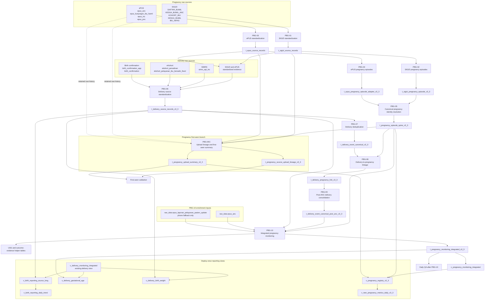

# Purbalingga data pipeline diagram

This diagram traces the Purbalingga pipeline from retained raw sources through
canonical pregnancy and delivery processing, first-seen lineage, integrated
monitoring, QA, and the deploy-once reporting views.

The editable Mermaid source is available in
[`PURBALINGGA_PIPELINE_DIAGRAM.mmd`](PURBALINGGA_PIPELINE_DIAGRAM.mmd).

## Scheduling interpretation

- PBG-01 → PBG-02 and PBG-03 → PBG-04 may run as parallel source branches.
- PBG-05 starts only after PBG-02 and PBG-04 succeed.
- PBG-05C starts after PBG-05 and can run in parallel with the delivery branch.
- PBG-06 → PBG-07 prepares canonical delivery evidence.
- PBG-08 starts after PBG-05 and PBG-07, followed by PBG-09 and PBG-10.
- PBG-10 and its QA run daily. Its operational status uses the current Jakarta date.
- Files in `views_deploy_once/` are deployed when definitions change; they are
  not daily scheduled queries.

## Important source roles

- `IBU_NIFAS`, `epus_inc`, and `epus_pnc` provide supporting pregnancy or
  delivery evidence; they do not independently create a new pregnancy episode.
- `raw_data.epus_laporan_pelayanan_pasien_update` is a phone-enrichment fallback
  through a trusted maternal NIK. It does not create pregnancy membership.
- First-seen scope records the system where the final canonical pregnancy first
  became observable. It is different from the final pregnancy source combination.
